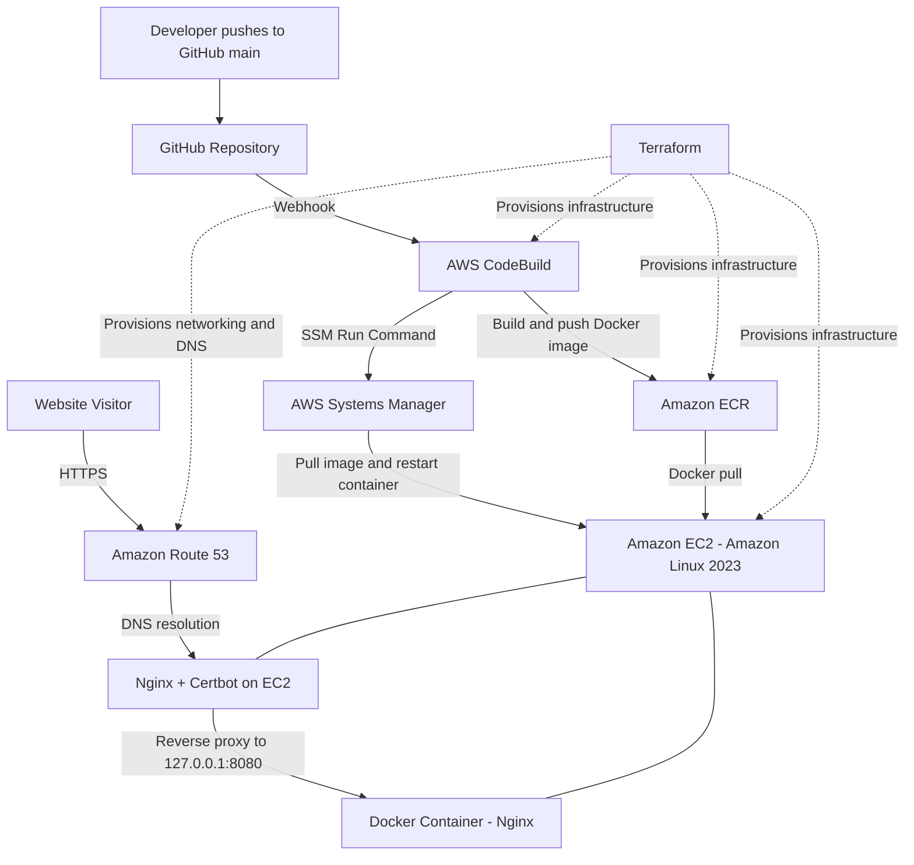

# AWS DevOps Portfolio | Terraform, Docker & Automated CI/CD

[](https://mohanad-portfolio.click)
[](https://aws.amazon.com/)
[](https://www.terraform.io/)
[](https://www.docker.com/)

**Live website:** https://mohanad-portfolio.click  
**Repository:** https://github.com/Mohanadqasim/devops-portfolio

## Overview

This project is my personal **DevOps and Cloud Engineering portfolio**, hosted on AWS and deployed through an automated CI/CD workflow. The website introduces my background, cloud certifications, technical skills, and practical projects. More importantly, the website itself is a hands-on demonstration of **Infrastructure as Code, containerization, AWS automation, and cloud operations**.

The infrastructure is provisioned with **Terraform**. A push to the GitHub `main` branch triggers **AWS CodeBuild**, which builds a Docker image, pushes it to **Amazon ECR**, and uses **AWS Systems Manager (SSM)** to deploy the updated container to an **Amazon EC2** instance. **Nginx** serves as a reverse proxy, while **Let's Encrypt / Certbot** provides HTTPS and automatic certificate renewal.

> **Project scope:** This is a lightweight, single-instance portfolio deployment intended to demonstrate practical DevOps skills. It is not presented as a highly available production architecture.

## Architecture



### AWS services and tools

| Technology | Purpose |
| --- | --- |
| **Terraform** | Infrastructure provisioning and configuration management |
| **Amazon VPC, public subnet, internet gateway, route table** | Networking for the EC2 host |
| **Security groups** | Control inbound HTTP/HTTPS traffic and outbound connectivity |
| **Amazon EC2 (Amazon Linux 2023)** | Host the Dockerized portfolio |
| **Elastic IP** | Stable public address for the instance |
| **GitHub + webhook** | Source control and automatic build trigger |
| **AWS CodeBuild** | Build, tag, push, and deploy container releases |
| **Amazon ECR** | Store versioned Docker images |
| **AWS IAM** | Grant EC2 and CodeBuild required permissions |
| **AWS Systems Manager** | Run deployment commands on EC2 without opening SSH |
| **Amazon Route 53** | DNS for the apex and `www` domains |
| **Docker** | Package and run the website consistently |
| **Nginx** | Serve static files inside the container and reverse-proxy HTTPS traffic on the host |
| **Let's Encrypt / Certbot** | TLS certificates and scheduled renewal |

**AWS Region:** `us-east-1` (N. Virginia).

## How the CI/CD pipeline works

1. **Source:** A change is committed and pushed to the GitHub `main` branch.
2. **Trigger:** The GitHub webhook automatically starts the CodeBuild project.
3. **Build:** CodeBuild reads the repository's `buildspec.yml` and builds the website's Docker image.
4. **Publish:** The image is tagged and pushed to Amazon ECR.
5. **Deploy:** CodeBuild uses AWS Systems Manager to execute the deployment script on EC2.
6. **Release:** EC2 authenticates to ECR, pulls the new image, replaces the running `devops-portfolio` container, and performs a local HTTP health check.
7. **Serve:** Host-level Nginx proxies requests to the container on `127.0.0.1:8080`; Certbot manages the HTTPS certificate.

**No manual EC2 login is needed for normal deployments.**

## Verified deployment

The pipeline was tested with actual pushes to `main`, rather than only manual builds.

| Verification | Observed result |
| --- | --- |
| Terraform validation | `Success! The configuration is valid.` |
| Terraform plan after final fixes | `No changes. Your infrastructure matches the configuration.` |
| GitHub webhook | CodeBuild initiator `GitHub-Hookshot/edb4508` |
| Git commit deployed through pipeline | `4ea94b4f7ed8d6b4c9c04af111dbf997eaf19e71` |
| CodeBuild execution | `SUCCEEDED` |
| Build, publish and deployment phase | `BUILD` and `POST_BUILD` both `SUCCEEDED` |
| Docker container | Running on EC2, bound to `127.0.0.1:8080` |
| Local HTTP and HTTPS checks | Both returned `HTTP/1.1 200 OK` |
| Certificate renewal | `certbot-renew.timer` enabled and scheduled |

> These are results from the October 2026 implementation and verification sessions, not a real-time uptime or pipeline-status indicator.

## Website features

The portfolio is a responsive, dark-themed static website built with **HTML, Tailwind CSS, JavaScript, Font Awesome, and Google Fonts**. It includes:

- **About Me & Vision:** Cloud engineering focus and approach to infrastructure automation.
- **Certifications:** AWS and Oracle Cloud credentials presented by level.
- **Technical Skills Matrix:** Cloud platforms, IaC/CI/CD, containers, and monitoring.
- **CI/CD & Cloud Showcase:** The automated AWS portfolio deployment project.
- **AWS Architecture Specs:** An overview of the infrastructure and deployment workflow.
- **Contact:** Email, social links, and a mailto-based contact form.

The portfolio highlights cloud and DevOps work, while the frontend remains intentionally simple so that the infrastructure and deployment automation are the main focus.

## Repository components

The key files and folders used in this project include:

| Path | Responsibility |
| --- | --- |
| `index.html` | Main portfolio webpage |
| `Dockerfile` | Builds the website container image |
| `buildspec.yml` | Defines the CodeBuild CI/CD steps |
| `terraform/` | Terraform resources for AWS infrastructure |
| `terraform/ec2.tf` | EC2 instance and associated configuration |
| `terraform/codebuild.tf` | CodeBuild configuration and related integration |
| `terraform/route53.tf` | Domain DNS records |
| `terraform/user_data.sh.tftpl` | EC2 bootstrap template |
| `deploy.sh` | Deployment script used to update the container (where maintained in the repository) |

> Exact file organization may evolve; see the repository for the current source of truth.

## Infrastructure and deployment details

### EC2 bootstrap

The EC2 initialization process installs Docker, Nginx, and Certbot; enables the Docker and SSM services; writes the deployment and Nginx configuration; and sets up HTTPS provisioning. The instance uses an IAM instance profile with **`AmazonSSMManagedInstanceCore`** and ECR read access.

### Container deployment

The deployed container is named `devops-portfolio`. The application listens on port `80` **inside** the container and is published only to the EC2 loopback interface as `127.0.0.1:8080`. Host Nginx handles public requests on ports `80` and `443` and forwards application traffic to the container.

### HTTPS and DNS

Route 53 resolves `mohanad-portfolio.click` and `www.mohanad-portfolio.click` to the EC2 Elastic IP. Let's Encrypt issues the TLS certificate through Certbot's Nginx integration. A systemd renewal timer is enabled for future renewals.

## Prerequisites for recreating the project

- AWS account with permissions to manage the services listed above
- AWS CLI configured with appropriate credentials
- Terraform `>= 1.0.0` and the AWS provider used by the configuration
- Docker for optional local testing
- A GitHub repository and an authorized AWS connection for CodeBuild source access
- A registered domain and Route 53 hosted zone, or appropriate DNS configuration

### Terraform workflow

```bash
cd terraform
terraform init
terraform fmt -recursive
terraform validate
terraform plan
```

Review the plan before provisioning:

```bash
terraform apply
```

**Caution:** Terraform resources and bootstrap scripts are specific to the account and domain configuration. Review variables, IAM permissions, domain settings, and instance costs before applying. Updating EC2 user data can affect a running instance; this project currently ignores `ami` and `user_data` drift in its EC2 lifecycle configuration, so bootstrap changes require deliberate rollout planning.

### Typical development workflow

```bash
git add .
git commit -m "Update portfolio"
git push origin main
```

The webhook starts the build automatically; **do not manually start CodeBuild** for the normal deployment workflow.

### Useful verification commands

Check recent builds:

```bash
aws codebuild list-builds-for-project \
  --project-name devops-portfolio-build \
  --region us-east-1 \
  --sort-order DESCENDING \
  --query 'ids[:5]' \
  --output json
```

Validate the live HTTPS response:

```bash
curl -I https://mohanad-portfolio.click
```

For instance-level diagnostics, use AWS Systems Manager Run Command rather than exposing SSH access.

## Security and operational choices

- **No inbound SSH required:** EC2 management and deployment use AWS Systems Manager.
- **Scoped AWS roles:** EC2 has SSM and ECR pull permissions; CodeBuild uses a dedicated IAM role.
- **Private application listener:** Docker publishes the container only on `127.0.0.1:8080`.
- **HTTPS:** Public website traffic uses a Let's Encrypt certificate managed by Certbot.
- **Stable DNS:** Route 53 records point to an Elastic IP.
- **Git hygiene:** Terraform state, `.tfvars`, private keys, local provider caches, and generated binaries are excluded from version control.

**Note:** Local Terraform state must still be protected and backed up securely. Ignoring it in Git does not provide encryption or remote backup.

## Troubleshooting lessons learned

Building the project included several real infrastructure issues and fixes:

- **CodeBuild GitHub access:** Configured the AWS CodeConnections authorization and IAM permissions needed to fetch the GitHub source.
- **EC2 bootstrap failure:** Diagnosed a cloud-init `Exec format error` caused by a blank line before the shell shebang, corrected the bootstrap template, and reran initialization through SSM.
- **Amazon Linux package compatibility:** Removed an unnecessary `curl` package installation from the bootstrap command.
- **Deployment-script execution:** Fixed the deployment script's first line so it can execute directly.
- **HTTPS setup:** Configured Nginx, issued the Let's Encrypt certificate, and enabled scheduled renewal.
- **Terraform drift:** Confirmed a no-change plan after protecting the running instance from incidental AMI and user-data updates.
- **Webhook verification:** Confirmed that a GitHub push triggered CodeBuild and that all build phases succeeded.

These troubleshooting steps are part of the project's DevOps learning outcomes: reading logs, isolating root causes, applying minimal fixes, and validating the result.

## Future improvements

- Add CloudWatch alarms and deployment failure notifications.
- Add deployment rollback and protection against concurrent releases.
- Move Terraform state to a secured, versioned remote backend.
- Add automated container checks and deployment smoke tests.
- Add architecture screenshots and CI/CD execution screenshots to the repository.

## About me

**Mohanad Qasim** — DevOps & Cloud Engineering portfolio focused on AWS, Infrastructure as Code, Linux, Docker, and CI/CD automation.

- **Portfolio:** https://mohanad-portfolio.click
- **GitHub:** https://github.com/Mohanadqasim
- **LinkedIn:** https://linkedin.com/in/mohanadqasim

---

*Built to demonstrate practical cloud infrastructure, deployment automation, and troubleshooting skills.*
